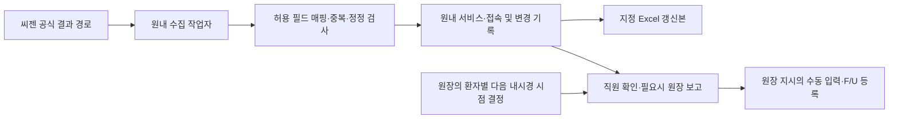

# ADR-005: 원내 씨젠 결과 수집·지정 Excel 갱신 제안

작성일: 2026-10-22. 상태: **수집 연동은 설계 제안. 사용자 지시로 합성 Excel 프로토타입부터 구현하며 실제 로그인·실데이터 연결은 미착수.**

## 문제와 사용자 의도

사무장과 지정 직원이 씨젠 결과를 확인해 정해진 Excel 양식에 옮기는 반복 업무를 자동화한다. 원장은 조직검체 결과를 보고 환자별 다음 내시경 시점을 결정한다. 자동 수집·전사와 원장 임상 판단은 별개 행위다. 직원의 별도 보고가 모든 결과에 필요한지와 원장의 환자별 F/U 결정 주체가 누구인지는 구분한다.

사용자는 병원 계정으로 씨젠 결과를 매일 조회하고 기존 양식을 갱신하는 원내 웹앱을 요청했다. 새 요청은 이전의 포털 자동 조회 금지·외부 통신 0·Excel Export 없음이라는 범위를 바꾸려는 의도로 기록한다. 이전 금지사항만을 근거로 요청을 거절하지 않는다. 구현 방식과 원문 저장 범위·원내 실행 환경은 아직 정해지지 않았다.

## 공개 자료에서 확인한 것과 미확인 사항

- 씨젠 공식 안내는 결과의 온라인 조회와 결과 조회 화면의 다운로드를 안내한다. **Excel 형식·내부 앱용 API·브라우저 자동화 허용 여부를 이 안내만으로 확정할 수 없다.** [씨젠 검사의뢰 절차](https://pr.seegenemedical.com/task/step/index.do)
- 공식 문의 경로는 씨젠 Talk이다. 이 문서 작성 중 문의 발송·기관 접촉은 수행하지 않았다. [씨젠 Talk](https://pr.seegenemedical.com/customer/talk/index.do)
- 사용자 제공 결과조회 URL은 `https://srms.seegenemedical.com/main.do`다. 인증정보 없는 접근은 `/session_out.jsp` 이동만 확인했고 로그인 뒤 기능은 확인하지 않았다. 열 17개와 결과/위치 약어 기입 방식은 확인됐다. 다운로드 항목·보안 절차·수식·수동 입력 범위는 추가 확인한다(Q18). ID·비밀번호·환자 파일을 채팅으로 받지 않는다.

## 제안 구조

1. **공식 경로를 먼저 확인:** 귀원에서 이용 가능한 공식 연동/API 또는 결과 파일 다운로드를 우선 검토한다. 공개 API가 있다고 가정하거나 비공개 endpoint를 추측하지 않는다. 의사랑 DB 접근·연동은 이번 변경에도 포함하지 않는다.
2. **브라우저 자동화는 조건부 후보:** 공식 경로가 적합하지 않으면 씨젠이 허용하는 범위와 실제 로그인 절차를 확인한 뒤 로컬 브라우저 자동화를 검토한다. CAPTCHA·MFA·인증서·계정 잠금을 우회하지 않는다. 무인 로그인이 불가능하면 수동 로그인 또는 파일 다운로드를 남기는 방식으로 조정한다. Playwright 등 패키지와 브라우저 runtime 도입은 이 ADR을 구체화할 때 결정하며 지금 추가하지 않는다.
3. **원내 수집 작업자 분리:** 웹 UI는 LAN에 두고 수집 작업자만 씨젠 결과·인증에 필요한 확인된 목적지로 HTTPS 통신한다. 필요한 인증 의존 주소도 확인하고 최소 허용목록에 포함한다. 무제한 인터넷 연결이나 TLS 인증서 검증 해제로 해결하지 않는다. 별도 컨테이너/원내 OS 예약 작업 중 실행 형태는 Q18의 서버 환경과 비밀정보 저장 방식에 따라 정한다.
4. **동일 서비스 계층 사용:** 수집 결과는 검증한 최소 필드를 원내 서비스로 전달한다. SYSTEM actor의 수집 권한만 사용하고 Audit·AccessLog·실행 이력을 남긴다. DB 직접 쓰기·원장 판단 입력·환자 발송 권한은 주지 않는다.
5. **Excel은 매핑 계약으로 갱신:** 열 이름·셀 위치·시트·수식·수동 입력 열을 명시한다. 자동 수집 열과 원장/직원 입력 열의 소유권을 나누고 수동 입력을 자동 덮어쓰지 않는다. 어느 데이터의 원본이 DB/Excel인지 열별로 확정한다. 잠긴 파일·열 변경·수식 손상·동시 편집은 실패 또는 검토 대기로 처리한다.

## 인증정보·데이터 경계

- 병원 ID·비밀번호는 향후 운영자가 원내 환경에서 직접 등록한다. OS 자격증명 저장소 등에서 제한된 작업 계정만 읽게 하는 방식을 검토한다. Windows 저장소와 Docker 실행 계정 간 전달 방법도 검증 대상이며 접근 가능하다고 가정하지 않는다.
- 비밀번호·세션 쿠키·토큰은 Git·Excel·명령행·작업 로그·브라우저 trace·스크린샷에 남기지 않는다. `.env`를 Git에서 제외하는 것만으로 안전한 비밀정보 보관이 완성됐다고 보지 않는다.
- 환자정보와 보고서를 ChatGPT·외부 AI·외부 OCR·클라우드 동기화로 보내지 않는다. 개발자는 합성 fixture와 헤더/형식 정보로 개발하고, 실데이터 검증은 별도 원내 승인 절차를 따른다.
- **병리 소견 원문을 Excel/DB에 저장할지는 미확정이다.** '결과를 정리'한다는 요청을 원문 저장·PDF 자동 파싱 허가로 확대 해석하지 않는다. 필요한 열을 확인하고 별도 보유·접근·파기·백업 정책을 정한다. 원문을 저장하지 않아도 수집 과정에서 일시 취급하는 데이터는 민감정보로 다룬다.
- Excel 갱신은 새로운 출력 경로다. LAN 내부 파일도 접근권한·파일 복사·인쇄·보유·백업 관리와 실행 기록이 필요하다. 화면 이름 마스킹과 실제 양식의 필수 식별 항목도 구분해 정한다.
- 다음 내시경 날짜·F/U 필요성·결과 임상 분류는 자동 추론하지 않는다. 수집 성공을 원장 확인 완료나 환자 안내 완료로 처리하지 않는다.

## 일정·중복·실패 복구

- 매일 실행은 원내 서버의 예약 작업으로 구현한다. Codex 대화의 알림·자동 깨우기나 클라우드 작업으로 환자 결과를 수집하지 않는다. 하루 1회라면 게시 후 다음 실행까지 반영 지연이 있을 수 있으며 '게시 즉시' 요구는 별도 주기 확인이 필요하다.
- 최초 조회 시작일·매일 재조회 범위·정정본 확인 범위를 설정한다. 마지막 성공 시각만 보지 않고 일정 구간을 다시 대조해 늦게 공개된 결과·정정을 찾는다. 기간·실행시각은 설정값이며 지금 임의 확정하지 않는다.
- 수탁기관의 안정 접수/보고서 번호와 결과 버전 등 확인 가능한 키로 중복을 검사한다. 이름만으로 환자를 매칭하지 않는다. 식별자 불충분·의뢰 다건·서로 다른 환자 의심은 검토 대기로 둔다.
- 동일 자료를 두 번 처리해도 같은 행이 중복 추가되지 않아야 한다. 정정본은 기존 내용과 변경 기록을 대조하며 원장 날짜·직원 메모를 임의 변경하지 않는다.
- 초기 합성 검증에서는 원본을 덮어쓰지 않고 별도 갱신본을 만든다. 안정화 후 지정 파일 자동 반영은 파일 잠금·검증·동일 디스크 임시본의 원자적 교체·변경 전 상태 복구를 포함해 구현한다. 추가 사본의 보유·파기도 함께 관리한다.
- 로그인 실패·인증 요구·사이트 구조 변경·결과 누락·파일 잠금을 '신규 결과 없음'으로 표시하지 않는다. 마지막 성공·오류 코드·미처리 건수·수동 재실행을 화면에 표시한다. 실패 시 기존 양식을 보존하고 통제된 재시도로 계정 잠금을 피한다.

## 구현 전 필요한 정보 — Q18

| 묶음 | 필요한 정보 | 받지 않는 정보 |
|---|---|---|
| 접속 경로 | 로그인 전 공개 결과조회 URL, 공식 다운로드/연동 기능 유무, 인증 절차 종류 | 병원 ID/PW·쿠키·토큰·인증서 개인키 |
| Excel 계약 | 열 이름·시트/수식 설명, 자동/수동 입력 열, 원문 필요 여부 | 실제 환자 데이터·실제 결과지 |
| 원내 실행 | 상시 켜진 PC/서버, 저장 위치의 종류, 동시 Excel 편집 여부 | 계정 비밀정보·환자 파일 경로의 내용 |

## 구현 순서와 완료 증거 제안

1. **합성 데이터로 양식 갱신부터:** 허용 필드 매핑, 중복 방지, 원장·직원 열 보존, 파일 잠금·손상 실패 처리를 검증한다. 처음에는 씨젠 로그인 없이 재현 가능한 로컬 입력을 사용한다.
2. **확인된 씨젠 수집 adapter:** 공식 경로 또는 허용된 로컬 자동화 중 하나를 선택하고 합성 adapter fixture로 검증한다. 실제 계정 연결은 원내에서 운영자가 설정하며 개발 대화로 환자 자료를 가져오지 않는다.
3. **일일 작업·웹 화면 연결:** 실행 이력·신규/정정·실패·마지막 성공 시각·수동 재실행·원장 지시 입력을 제공한다. 재실행 시 중복 0, 수동 열 변경 0, 인증정보 로그 0, 미허용 외부 목적지 통신 거부를 검증한다.

기존 P13 '외부 통신 0' 시험은 이 제안 채택 시 '수집 작업자의 승인 목적지 외 통신 0, 웹앱의 불필요 외부 통신 0'으로 명세를 개정해야 한다. P12 'Export 없음'과 원문 미저장 요구도 실제 Excel 열 범위에 맞춰 명시적으로 갱신한다. 기존 시험을 통과한 것처럼 표시하지 않는다.

사용자가 약어 사전은 나중에 주고 다음 단계로 진행하도록 하여, [합성 Excel 프로토타입](../excel-prototype.md)을 먼저 구현한다. 수집 연동·원문 저장 정책·정식 DB·인증·원내 배포·실데이터 전환은 별도다. 정식 범위를 정한 뒤 YAML·Rule·상태도·E2E·compliance를 함께 개정하며, 이번 요청만으로 미래 Lab 모듈·AI 기능·EMR DB 접근을 추가하지 않는다.
