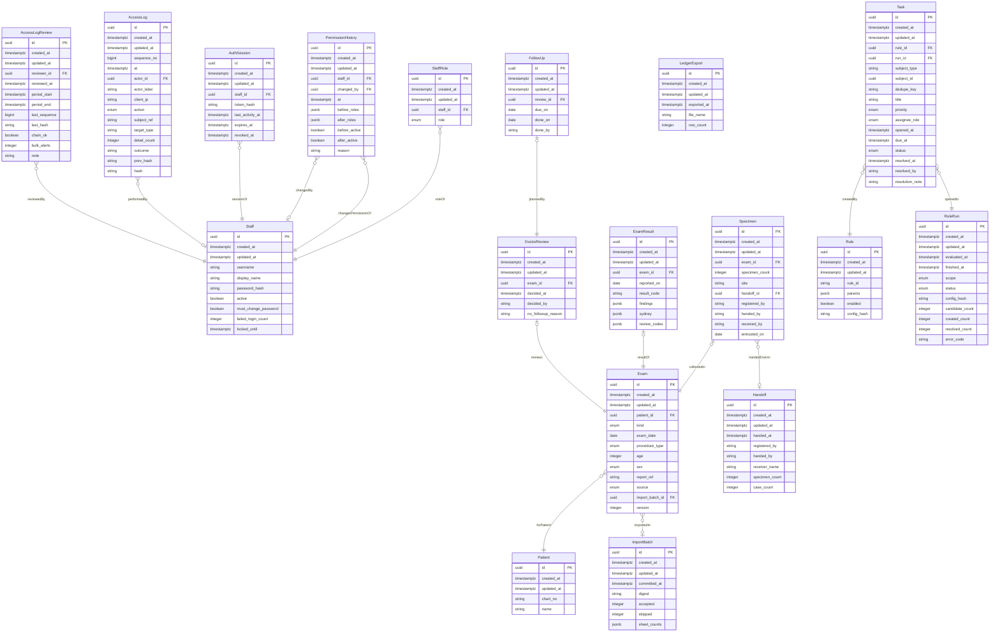

# ERD

> 원천: `ontology/coriops.yaml` · SHA-256 `7c89601323c341de2bf088f8aebbc41710b99e016ebff955eab44cd1803746e4`
> `python scripts/gen_docs.py`가 만든 문서다. 직접 고치지 말고 YAML을 고친 뒤 다시 만든다.

공통 필드(id·created_at·updated_at)는 모든 테이블에 있다. 관계는 각 클래스의 `references` 필드에서 만든다. JSONB 안에 들어가는 구성 요소(ReportFinding·SydneyGrading)와 config 등록값(ResultCode)은 그림에서 뺐다.

## 단계별 테이블

| 클래스 | 테이블 | 상태 |
|---|---|---|
| Staff | `staff` | 구현됨 |
| StaffRole | `staff_roles` | 구현됨 |
| PermissionHistory | `permission_history` | 구현됨 |
| AuthSession | `auth_sessions` | 구현됨 |
| AccessLog | `access_logs` | 구현됨 |
| AccessLogReview | `access_log_reviews` | 구현됨 |
| Patient | `patients` | 구현됨 |
| Exam | `exams` | 구현됨 |
| Specimen | `specimens` | 구현됨 |
| ExamResult | `exam_results` | 구현됨 |
| DoctorReview | `doctor_reviews` | 구현됨 |
| FollowUp | `followups` | 구현됨 |
| Handoff | `ledger_handoffs` | 구현됨 |
| ImportBatch | `ledger_import_batches` | 구현됨 |
| LedgerExport | `ledger_exports` | 구현됨 |
| Rule | `rules` | 구현됨 |
| RuleRun | `rule_runs` | 구현됨 |
| Task | `tasks` | 구현됨 |
