# ERD

> 원천: `ontology/coriops.yaml` · SHA-256 `3219555deb849c8c405298597adbeacd79b3032992a172c5bc72bc5559ae6704`
> Phase 0 일회성 로컬 생성 스냅샷. 영구 생성기·CI 일치 검사는 Phase 1 예정. 직접 편집하지 않는다.

UUID PK와 모든 created_at/updated_at을 포함한다. 별도 보유 로그의 entity UUID·patient_ref는 의도적인 논리 참조다.

```mermaid
erDiagram
    Patient {
        uuid id PK
        timestamptz created_at
        timestamptz updated_at
        string chart_no
        string name
        date birth_date
        enum sex
        enum status
    }
    Staff {
        uuid id PK
        timestamptz created_at
        timestamptz updated_at
        string username
        string display_name
        string password_hash
        boolean active
        integer failed_login_count
        timestamptz locked_until
    }
    StaffRole {
        uuid id PK
        timestamptz created_at
        timestamptz updated_at
        uuid staff_id FK
        enum role
    }
    AuthSession {
        uuid id PK
        timestamptz created_at
        timestamptz updated_at
        uuid staff_id FK
        string token_hash
        timestamptz last_activity_at
        timestamptz expires_at
        timestamptz revoked_at
    }
    SubjectReference {
        uuid id PK
        timestamptz created_at
        timestamptz updated_at
        string subject_type
        uuid patient_id FK
    }
    WorkCycle {
        uuid id PK
        timestamptz created_at
        timestamptz updated_at
        string subject_type
        uuid subject_id
        integer cycle_no
        timestamptz opened_at
        timestamptz ended_at
        string reason_code
    }
    FollowUpKind {
        uuid id PK
        timestamptz created_at
        timestamptz updated_at
        string code
        string owner
        string label
    }
    FollowUpPlan {
        uuid id PK
        timestamptz created_at
        timestamptz updated_at
        uuid patient_id FK
        string subject_type
        uuid subject_id
        uuid source_cycle_id FK
        string kind
        date due_date
        enum status
        enum review_status
        integer revision_no
        timestamptz completed_at
        string cancellation_reason
    }
    PatientNotification {
        uuid id PK
        timestamptz created_at
        timestamptz updated_at
        string subject_type
        uuid subject_id
        uuid cycle_id FK
        integer attempt_no
        enum method
        timestamptz attempted_at
        enum outcome
        uuid staff_id FK
    }
    Rule {
        uuid id PK
        timestamptz created_at
        timestamptz updated_at
        string rule_id
        jsonb params
        boolean enabled
        string config_hash
    }
    RuleRun {
        uuid id PK
        timestamptz created_at
        timestamptz updated_at
        uuid rule_id FK
        enum actor_type
        timestamptz evaluated_at
        timestamptz finished_at
        enum status
        string config_hash
        integer candidate_count
        string error_code
    }
    Task {
        uuid id PK
        timestamptz created_at
        timestamptz updated_at
        uuid rule_id FK
        string subject_type
        uuid subject_id
        uuid cycle_id FK
        string dedupe_key
        string title
        enum priority
        enum assignee_role
        timestamptz opened_at
        timestamptz due_at
        enum status
        timestamptz resolved_at
        timestamptz condition_cleared_at
        string resolution_note
    }
    AuditEvent {
        uuid id PK
        timestamptz created_at
        timestamptz updated_at
        enum actor_type
        uuid actor_id FK
        timestamptz at
        string entity_type
        uuid entity_id
        string action
        jsonb before
        jsonb after
        string reason_code
        string reason
        uuid correlation_id
    }
    AccessLogSegment {
        uuid id PK
        timestamptz created_at
        timestamptz updated_at
        timestamptz period_start
        timestamptz period_end
        string opening_checkpoint
        string previous_segment_hash
    }
    AccessLog {
        uuid id PK
        timestamptz created_at
        timestamptz updated_at
        uuid segment_id FK
        bigint sequence_no
        enum actor_type
        uuid actor_id FK
        string actor_label
        timestamptz at
        inet client_ip
        uuid patient_ref
        enum action
        string target_type
        uuid target_id
        string outcome_code
        uuid correlation_id
        string prev_hash
        string hash
    }
    AccessLogReview {
        uuid id PK
        timestamptz created_at
        timestamptz updated_at
        uuid reviewer_id FK
        timestamptz reviewed_at
        timestamptz period_start
        timestamptz period_end
        jsonb filters
        bigint last_sequence
        string last_hash
        enum disposition
        string followup_note
    }
    PermissionHistory {
        uuid id PK
        timestamptz created_at
        timestamptz updated_at
        uuid staff_id FK
        uuid changed_by FK
        timestamptz at
        jsonb before_roles
        jsonb after_roles
        boolean before_active
        boolean after_active
        string reason
    }
    PurgeBatch {
        uuid id PK
        timestamptz created_at
        timestamptz updated_at
        uuid requested_by FK
        uuid approved_by FK
        timestamptz approved_at
        timestamptz completed_at
        enum status
        string policy_version
        string manifest_hash
        string error_code
    }
    PurgeItem {
        uuid id PK
        timestamptz created_at
        timestamptz updated_at
        uuid batch_id FK
        string subject_type
        uuid subject_id
        string eligibility_snapshot_hash
        timestamptz deleted_at
    }
    ImportBatch {
        uuid id PK
        timestamptz created_at
        timestamptz updated_at
        uuid committed_by FK
        string mapping_version
        string normalized_digest
        enum status
        integer accepted_count
        integer rejected_count
    }
    EndoscopyProcedure {
        uuid id PK
        timestamptz created_at
        timestamptz updated_at
        uuid patient_id FK
        timestamptz performed_at
        enum type
        boolean sedation
        uuid performer_id FK
    }
    ExternalLab {
        uuid id PK
        timestamptz created_at
        timestamptz updated_at
        string name
        boolean active
    }
    PathologyRequest {
        uuid id PK
        timestamptz created_at
        timestamptz updated_at
        uuid procedure_id FK
        uuid external_lab_id FK
        timestamptz shipped_at
        string external_ref
        enum status
        uuid active_cycle_id FK
        uuid current_review_id FK
        integer version_no
        timestamptz result_complete_at
        timestamptz notified_at
        string notification_skip_reason
        timestamptz notification_waived_at
        timestamptz closed_at
        timestamptz terminal_at
    }
    Specimen {
        uuid id PK
        timestamptz created_at
        timestamptz updated_at
        uuid procedure_id FK
        uuid request_id FK
        integer seq_no
        string site
        enum method
        timestamptz collected_at
    }
    PathologyReport {
        uuid id PK
        timestamptz created_at
        timestamptz updated_at
        uuid request_id FK
        timestamptz received_at
        string report_ref
        string logical_report_key
        integer version_no
        uuid supersedes_id FK
        enum source
        string correction_reason
    }
    ReportSpecimen {
        uuid id PK
        timestamptz created_at
        timestamptz updated_at
        uuid report_id FK
        uuid specimen_id FK
    }
    ResultCode {
        uuid id PK
        timestamptz created_at
        timestamptz updated_at
        string code
        string label
        enum scope
        enum severity_tier
        boolean active
    }
    ReportFinding {
        uuid id PK
        timestamptz created_at
        timestamptz updated_at
        uuid report_id FK
        integer display_order
        string result_code
        jsonb modifiers
        integer lesion_count
    }
    SydneyGrading {
        uuid id PK
        timestamptz created_at
        timestamptz updated_at
        uuid report_id FK
        enum h_pylori
        enum neutrophil
        enum mononuclear
        enum atrophy
        enum intestinal_metaplasia
    }
    PhysicianReview {
        uuid id PK
        timestamptz created_at
        timestamptz updated_at
        uuid request_id FK
        uuid cycle_id FK
        string report_set_hash
        uuid ordered_by FK
        uuid entered_by FK
        timestamptz reviewed_at
        enum result_category
        enum urgency
        enum instruction
        string instruction_note
        enum followup_directive
        string followup_kind
        date followup_due_date
        string no_followup_reason
    }
    ReviewReport {
        uuid id PK
        timestamptz created_at
        timestamptz updated_at
        uuid review_id FK
        uuid report_id FK
    }
    Patient ||--o{ EndoscopyProcedure : undergoes
    EndoscopyProcedure }o--|| Staff : performedBy
    EndoscopyProcedure ||--o| PathologyRequest : hasRequest
    PathologyRequest ||--o{ Specimen : hasSpecimen
    Specimen }o--|| EndoscopyProcedure : collectedDuring
    PathologyRequest }o--|| ExternalLab : sentTo
    PathologyReport }o--|| PathologyRequest : resultOf
    PathologyReport }o--o{ Specimen : coversSpecimen
    PathologyReport o|--|| PathologyReport : supersedes
    PathologyReport ||--o{ ReportFinding : hasFinding
    ReportFinding }o--|| ResultCode : usesResultCode
    PathologyReport ||--o| SydneyGrading : hasGrading
    PhysicianReview }o--o{ PathologyReport : reviewsReports
    PhysicianReview }o--|| PathologyRequest : reviewsRequest
    PhysicianReview }o--|| Staff : reviewedBy
    PathologyRequest }o--o| PhysicianReview : usesCurrentReview
    PhysicianReview }o--|| Staff : enteredBy
    Staff ||--o{ StaffRole : hasRole
    SubjectReference }o--|| Patient : identifiesSubject
    SubjectReference ||--o{ WorkCycle : hasCycle
    Rule ||--o{ Task : createsTask
    RuleRun }o--|| Rule : evaluatesRule
    Task }o--|| SubjectReference : concernsSubject
    Task }o--|| WorkCycle : belongsToCycle
    PatientNotification }o--|| SubjectReference : notifiesAbout
    FollowUpPlan }o--|| SubjectReference : followsFrom
    FollowUpPlan }o--|| Patient : plansFor
    FollowUpPlan }o--|| FollowUpKind : usesKind
    AccessLog }o--|| AccessLogSegment : belongsToSegment
    PermissionHistory }o--|| Staff : changesPermissionOf
    PurgeBatch ||--o{ PurgeItem : includesPurge
```

N:M 관계의 실제 연결은 ReportSpecimen·ReviewReport 테이블이다. SubjectReference와 대상은 공유 PK이며 모듈별 커밋 시 검증한다. 엄밀한 nullable·unique·복합 FK 조건은 데이터 사전과 원천 YAML을 따른다.
