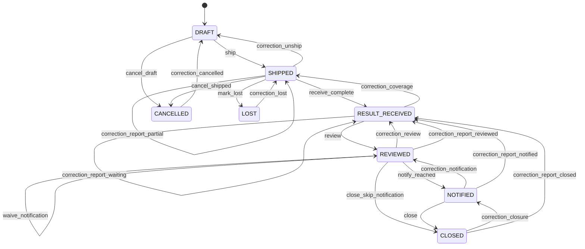

# PathologyRequest 상태 머신

> 원천: `ontology/coriops.yaml` · SHA-256 `3219555deb849c8c405298597adbeacd79b3032992a172c5bc72bc5559ae6704`
> Phase 0 일회성 로컬 생성 스냅샷. 영구 생성기·CI 일치 검사는 Phase 1 예정. 직접 편집하지 않는다.

선언형 전이 표의 guard는 모듈이 등록하고 kernel WorkflowEngine이 실행한다. 등록되지 않은 action/from/to는 모두 거부한다.

## 전이 표

| from | to | action | 필요 권한 | 사유 필수 | guard |
|---|---|---|---|---|---|
| DRAFT | SHIPPED | ship | request.ship | 아니오 | shipment_ready |
| SHIPPED | SHIPPED | receive_partial | report.receive | 아니오 | coverage_incomplete |
| SHIPPED | RESULT_RECEIVED | receive_complete | report.receive | 아니오 | coverage_complete |
| RESULT_RECEIVED | REVIEWED | review | review.record | 아니오 | current_report_set_reviewed |
| REVIEWED | REVIEWED | record_failed_attempt | notification.record | 아니오 | failed_notification |
| REVIEWED | NOTIFIED | notify_reached | notification.record | 아니오 | reached_current_cycle |
| REVIEWED | REVIEWED | waive_notification | notification.waive | 예 | instruction_none_and_doctor_authorized |
| REVIEWED | CLOSED | close_skip_notification | request.close | 예 | instruction_none_and_followup_satisfied |
| NOTIFIED | CLOSED | close | request.close | 아니오 | followup_satisfied |
| DRAFT | CANCELLED | cancel_draft | request.cancel | 예 | cancellable_draft |
| SHIPPED | CANCELLED | cancel_shipped | request.cancel | 예 | doctor_authorized_terminal |
| SHIPPED | LOST | mark_lost | request.mark_lost | 예 | doctor_authorized_terminal |
| SHIPPED | DRAFT | correction_unship | request.correct | 예 | no_reports_and_not_actually_shipped |
| RESULT_RECEIVED | SHIPPED | correction_coverage | request.correct | 예 | explicit_invalid_coverage |
| REVIEWED | RESULT_RECEIVED | correction_review | request.correct | 예 | doctor_authorized_correction |
| NOTIFIED | REVIEWED | correction_notification | request.correct | 예 | doctor_authorized_correction |
| CLOSED | NOTIFIED | correction_closure | request.correct | 예 | doctor_authorized_correction |
| SHIPPED | SHIPPED | correction_report_partial | report.correct | 예 | replacement_coverage_incomplete |
| RESULT_RECEIVED | RESULT_RECEIVED | correction_report_waiting | report.correct | 예 | replacement_coverage_complete |
| REVIEWED | RESULT_RECEIVED | correction_report_reviewed | report.correct | 예 | replacement_coverage_complete |
| NOTIFIED | RESULT_RECEIVED | correction_report_notified | report.correct | 예 | replacement_coverage_complete |
| CLOSED | RESULT_RECEIVED | correction_report_closed | report.correct | 예 | replacement_coverage_complete |
| CANCELLED | DRAFT | correction_cancelled | request.correct | 예 | never_shipped_and_doctor_authorized |
| LOST | SHIPPED | correction_lost | request.correct | 예 | original_specimens_located_and_doctor_authorized |

## Guard 정의

- `shipment_ready`: 검체 1병 이상·채취시각·시행의·유효 수탁기관·발송시각이 있고 모든 검체가 동일 시행·의뢰에 속함
- `coverage_incomplete`: 유효 보고서와 검체 coverage를 저장해도 전체 발송 검체를 포함하지 못함
- `coverage_complete`: 보고서 계열별 최신 버전의 coverage 합집합이 전체 발송 검체를 포함함
- `current_report_set_reviewed`: 최신 전체 보고서 집합 hash가 일치하고 active DOCTOR 지시·실제 입력자·F/U 필요성·날짜·분류가 모두 있음
- `failed_notification`: 현 회차의 유효 원장 지시에 대한 실패 outcome이며 attempt_no가 미사용 값임
- `reached_current_cycle`: 현 회차 REACHED 기록이며 현재 원장 지시에 대한 안내임
- `instruction_none_and_doctor_authorized`: 현재 원장 확인의 instruction이 NONE이며 원장 지시·생략 사유·생략시각이 있음
- `instruction_none_and_followup_satisfied`: NONE 생략 사유·시각·원장 지시가 있고 followup_satisfied를 충족함
- `followup_satisfied`: 유효한 현재 원장 확인과 REQUIRED의 대응 CURRENT PLANNED/BOOKED/DONE 계획 또는 NOT_REQUIRED의 원장 불필요 사유가 있음
- `cancellable_draft`: DRAFT이고 사유가 있으며 관련 후속 업무를 숨기지 않음
- `doctor_authorized_terminal`: 원장 지시·사유를 기록하고 기수신 결과·남은 F/U·재채취 필요성을 사람이 확인함
- `no_reports_and_not_actually_shipped`: 보고서가 없고 실제 발송하지 않은 오입력임을 원장이 확인함
- `explicit_invalid_coverage`: 잘못된 coverage를 버전 이력으로 정정해 전체 미완료가 되었으며 원장 지시·사유가 있음
- `doctor_authorized_correction`: active DOCTOR 지시·정정 사유가 있으며 유지·무효화할 근거를 명시함
- `replacement_coverage_incomplete`: 동일 계열의 직전 버전을 대체해도 전체 미완료이며 새 회차와 재확인 표시를 저장함
- `replacement_coverage_complete`: 동일 계열의 직전 버전을 대체해도 전체 검체 coverage가 유지되고 새 회차·확인 무효화·F/U 재확인을 저장함
- `never_shipped_and_doctor_authorized`: CANCELLED이나 실제 발송 이력이 없고 원장이 취소 오류를 확인함. 발송된 취소 건 재개는 별도 중단·확인
- `original_specimens_located_and_doctor_authorized`: LOST의 원래 검체를 찾았고 원장이 재개 승인함. 재채취는 새 시행·새 의뢰

## 정정의 영향

- `all_corrections`: 새 WorkCycle·Audit 생성, 이전 OPEN Task는 CYCLE_SUPERSEDED로 해소하고 과거 이력 보존
- `report_corrections`: current_review_id·notified_at·생략시각·closed_at 무효화, 이전 F/U는 RECONFIRM_REQUIRED
- `correction_review`: current_review_id 및 이후 안내·종결 근거 무효화
- `correction_notification`: report_set_hash가 같은 유효 review만 유지하고 안내 이후 근거 무효화
- `correction_closure`: 동일 보고서 집합의 유효 review·안내 근거를 명시적으로 유지하고 closed_at만 해제

## 적용 원칙

- 최초 생성은 DRAFT만 허용한다. 직접 status 대입·bulk/raw SQL 우회도 거부해야 한다.
- 모든 전이는 대상 잠금·guard 재검증·관련 업무기록·AuditEvent·AccessLog를 같은 트랜잭션에 남긴다.
- NONE 생략은 waive_notification으로 사유·시각을 먼저 기록할 수 있다. F/U가 아직 없으면 REVIEWED에 남고 R06을 즉시 생성한다. 이후 close_skip_notification은 그 원장 승인 사유를 재사용하고 F/U 충족을 검사한다.
- NOTIFIED는 안내 완료이지 F/U 등록 완료가 아니다. PLANNED/BOOKED/DONE 중 CURRENT 계획 또는 원장 불필요 사유가 있어야 CLOSED다.
- 정정으로 새 회차가 생겨도 유효한 이전 근거 유지 여부를 명시적으로 판정한다. 보고서 정정은 항상 기존 확인·안내를 무효화하고 재확인한다.
- 검체 전체 미완료·NEXT_VISIT·취소 후 재개 등 미확정 운영 처리는 docs/open-questions.md의 Gate를 따른다.
