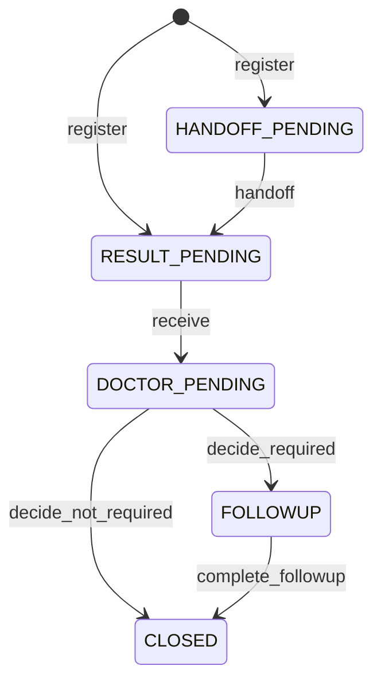

# Exam 단계

> 원천: `ontology/coriops.yaml` · SHA-256 `c35b8a3d18f2da87859f3ab5770c10c19a83fd7f0dc120a01d5a14801ea67f71`
> `python scripts/gen_docs.py`가 만든 문서다. 직접 고치지 말고 YAML을 고친 뒤 다시 만든다.

단계는 DB에 저장하지 않는다. 연결된 기록(인계·결과·원장 지시·재검 계획)이 있는지로 매번 계산하므로, 상태 값과 실제 기록이 어긋나지 않는다. 화면 버튼은 아래 전이만 허용하고 권한은 `config/security.yaml`을 따른다.

## 단계 계산 순서

위에서부터 처음 맞는 단계가 된다.

| 순서 | 단계 | 조건 |
|---|---|---|
| 1 | HANDOFF_PENDING (인계 대기) | 인계가 필요한 종류(config/ledger_app.yaml handoff=true)이고 위탁일이 없음 |
| 2 | RESULT_PENDING (결과 대기) | 결과보고일이 없음 |
| 3 | DOCTOR_PENDING (원장 지시 대기) | 원장 지시가 없음 |
| 4 | FOLLOWUP (재검 예정) | 재검 계획이 있고 재검 완료일이 없음 |
| 5 | CLOSED (종결) | 그 밖(재검 불필요 지시 또는 재검 완료) |

## 전이 표

| from | to | action | 권한 | guard |
|---|---|---|---|---|
| [*] | HANDOFF_PENDING | register | ledger.register | handoff_required |
| [*] | RESULT_PENDING | register | ledger.register | handoff_not_required |
| HANDOFF_PENDING | RESULT_PENDING | handoff | ledger.handoff | bottle_count_matches |
| RESULT_PENDING | DOCTOR_PENDING | receive | ledger.result | registered_notation |
| DOCTOR_PENDING | FOLLOWUP | decide_required | ledger.decide | doctor_due_date |
| DOCTOR_PENDING | CLOSED | decide_not_required | ledger.decide | doctor_reason |
| FOLLOWUP | CLOSED | complete_followup | ledger.followup | done_date_not_future |

## Guard 정의

- `handoff_required`: 종류의 handoff=true
- `handoff_not_required`: 종류의 handoff=false
- `bottle_count_matches`: 인계 대기 전체의 장부 병 수와 직원이 센 병 수가 같고 접수인·인계인·인수인이 모두 있음
- `registered_notation`: 조직검사는 등록 코드 표기, CLO·Stool은 20자 이내 판정. Sydney는 위 검체만
- `doctor_due_date`: 원장이 정한 재검 날짜가 있음(시스템이 간격을 계산하지 않음)
- `doctor_reason`: 재검 불필요 사유가 있음. 여러 건 일괄 지시는 하나라도 실패하면 전부 취소
- `done_date_not_future`: 재검 시행일이 오늘 이전

엑셀 가져오기(excel.import)는 새 행만 저장하며, 단계는 가져온 값(위탁일·결과보고일)으로 계산한다
